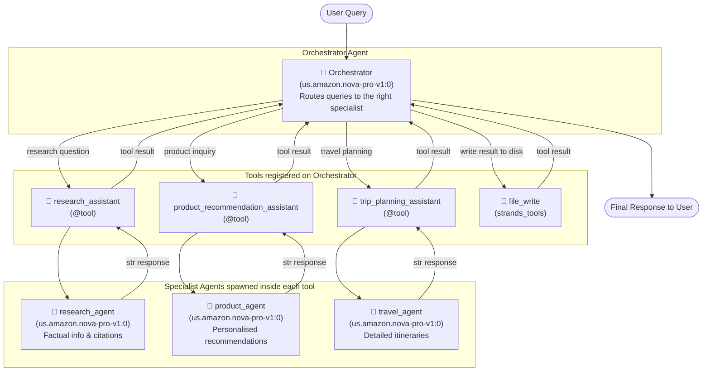
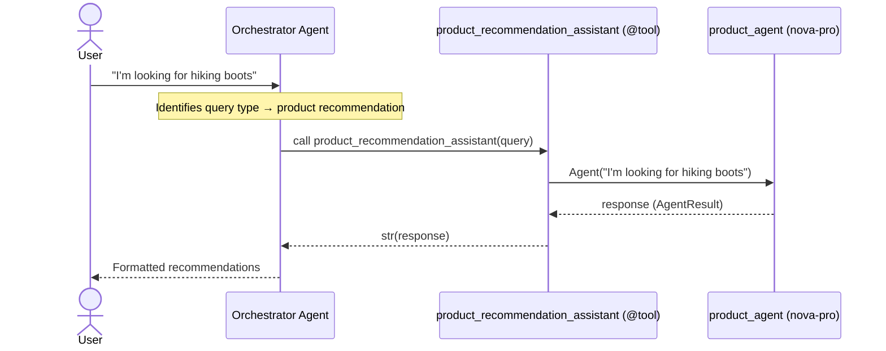
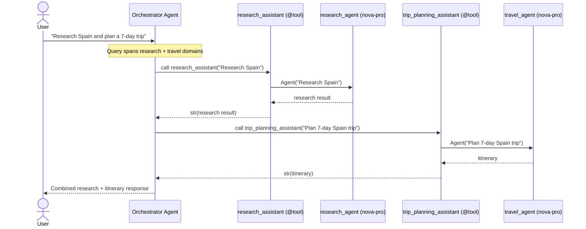

# Agents as Tools — Component Flow

This document shows how agents and tools connect to each other in the three patterns demonstrated in the notebook.

---

## Pattern 1: Orchestrator with Specialist Agents as Tools

The primary pattern: an orchestrator agent delegates work to specialist sub-agents that are each wrapped as a `@tool`.



---

## Pattern 2: Single-Query Tool Dispatch

How the orchestrator handles a single-domain query (e.g. "I'm looking for hiking boots").



---

## Pattern 3: Multi-Tool Dispatch (Parallel Specialists)

When a query spans multiple domains the orchestrator calls several specialist tools in sequence and combines the results.



---

## Pattern 4: Sequential Agent Pipeline (Research → Summary)

Agents chained directly (without an orchestrator) so the output of one feeds the input of the next.

```mermaid
graph LR
    User([Topic: Generative AI]) --> RA

    subgraph Step 1 — Research
        RA["🤖 research_agent\n(claude-sonnet-4-5)\nGathers comprehensive info"]
    end

    RA -->|"research_response\n.message['content'][0]['text']"| SA

    subgraph Step 2 — Summarise
        SA["🤖 summary_agent\n(claude-sonnet-4-5)\nDistils key points"]
    end

    SA --> Output([Concise Summary])
```

---

## Component Inventory

| Component | Type | Model | Responsibility |
|---|---|---|---|
| `orchestrator` | `Agent` | nova-pro-v1:0 | Routes queries; owns all tools |
| `research_assistant` | `@tool` wrapping `Agent` | nova-pro-v1:0 | Factual research with citations |
| `product_recommendation_assistant` | `@tool` wrapping `Agent` | nova-pro-v1:0 | Product suggestions |
| `trip_planning_assistant` | `@tool` wrapping `Agent` | nova-pro-v1:0 | Travel itineraries |
| `file_write` | `strands_tools` built-in tool | — | Writes output to disk |
| `research_agent` (pipeline) | `Agent` | claude-sonnet-4-5 | Deep research for sequential pattern |
| `summary_agent` (pipeline) | `Agent` | claude-sonnet-4-5 | Summarises research output |
